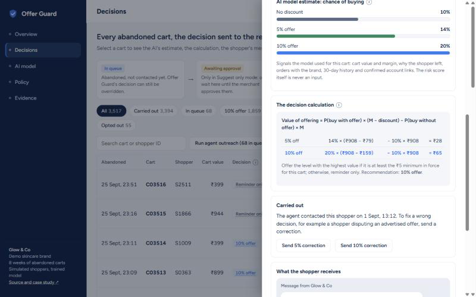
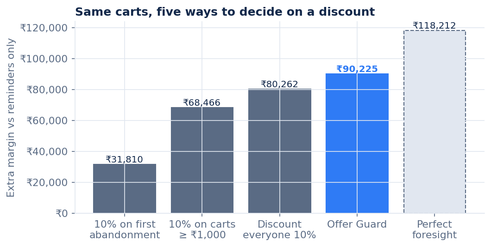
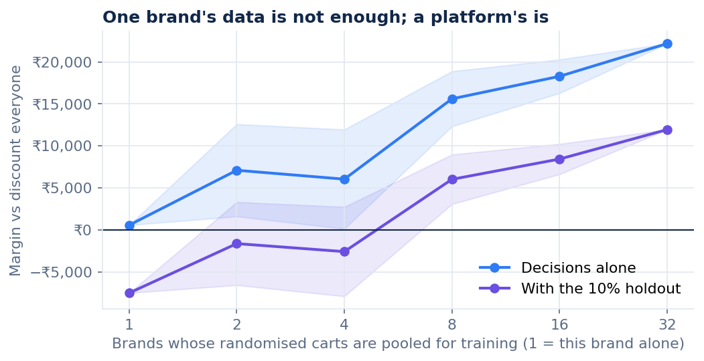
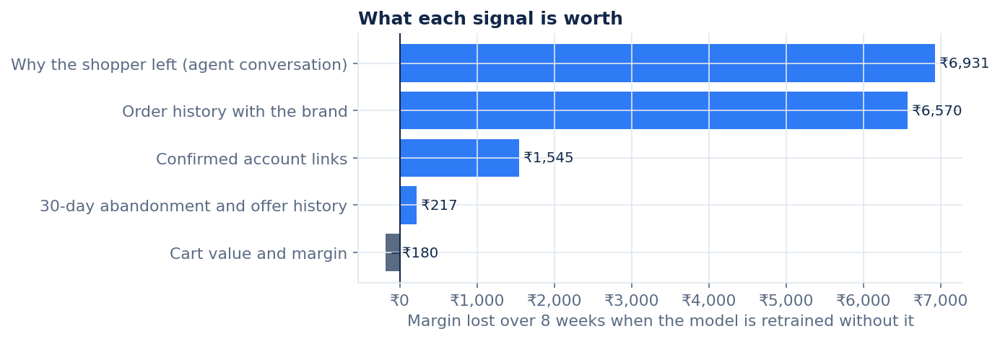
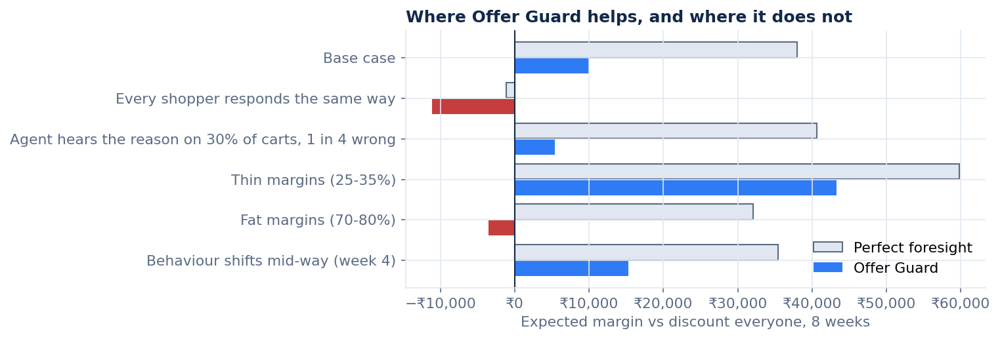
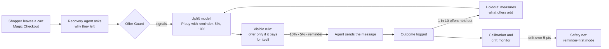

# Offer Guard

**Discounts for the shoppers who need one. Reminders for everyone else.**

An AI decision layer for a cart-recovery agent. For every shopper who abandons a cart, it predicts whether a discount will actually change their mind, and tells the agent to offer 10%, offer 5%, or send a plain reminder.

Built for the **Razorpay AI PM Build Challenge** (semi-finalist), then rebuilt end to end with a trained uplift model, a simulator, stress tests and a revised pilot plan.

**[Live dashboard](https://offer-guard-six.vercel.app/)** ([mirror](https://rithi-shetty.github.io/offer-guard/)) · [90-second demo](challenge-submission/Demo_Video.mp4) · [Product note](challenge-submission/Product_Note.pdf) · [Pitch deck](challenge-submission/Pitch_Deck.pptx) · [Decision log](docs/decisions.md)


---

## The problem

Priya buys every month and got distracted. Arjun is new and hesitated at the price. Both abandon a ₹2,000 cart, both get 10% off, both buy. The dashboard shows two "recovered" carts.

Only one was an extra sale. Priya would have come back anyway, so her ₹200 was margin given away. Shoppers who learn that abandoning brings a coupon start waiting for one.

Recovery tools report **recovery rate**, which goes up with every discount, including the loss-making ones. Nobody reports how many recovered carts would have come back on their own.

## What I built

| | Challenge version (v1) | Portfolio version (v2, this repo) |
|---|---|---|
| Product | Merchant dashboard: decisions with reasons, overrides, suggest-only mode, policy preview, pause switch, holdout | Same, plus an **Evidence** screen |
| AI estimates | Simulated, written into the data | **Trained uplift model** on randomised carts |
| Proof | Strategy comparison on one dataset | Learning curve, signal value, 6 stress tests, 20 fresh worlds, pilot power analysis |
| Engineering | One HTML file | Python package, 21 tests, CI, one-command pipeline, JS/Python parity check |

| Every decision shows its arithmetic | The Evidence screen shows the failures too |
|---|---|
|  |  |

## Results

Over 8 weeks, a simulated skincare brand had 3,394 abandoned carts that the agent contacted. The same carts were replayed under each strategy:

| | Discount everyone 10% | **Offer Guard** | Perfect foresight (ceiling) |
|---|---|---|---|
| Margin vs reminders only | ₹80,262 | **₹90,225** | ₹1,18,212 |
| Discount spend | ₹1,38,710 | **₹83,304 (−40%)** | ₹68,796 |
| Orders | 1,059 | **1,001 (−58)** | 1,015 |

*Expected values, with the 10% measurement holdout included. Realised outcomes, which include luck, point the same way: +₹9,267 margin against discounting everyone.*



- **+₹9,962 margin and 40% less discount spend** than discounting everyone, for 1.7 points lower recovery rate. Without the holdout the edge doubles to about +₹20,000; the holdout is the price of being able to *prove* the effect.
- **It isn't one lucky run.** In 20 freshly simulated brands, Offer Guard came out ahead in all 20 on expected margin and in 19 on realised margin. The median edge was +₹11,234, and it captured 53% of what perfect foresight would earn.
- **The holdout checks the model without trusting it.** Among the shoppers Offer Guard chose to discount, offers lifted purchases by 12.0 points (95% range 7.4 to 16.6). The model expected 9.2. Of the discounted buyers, 57% would have bought anyway.
- **Honest comparison with v1.** The challenge prototype claimed +₹17,855 and 54% less spend. Those came from simulated estimates. With a trained model the edge is smaller, and this README uses the smaller number.

## What the evidence changed

Rebuilding with a real model overturned some of my own assumptions. These are the parts I'd talk about in an interview; the full reasoning is in the [decision log](docs/decisions.md).

1. **It's a platform feature, not a plugin.** Trained only on one brand's own carts, Offer Guard *loses* ₹7,522 against discounting everyone. It needs about 8 brands' worth of randomised evidence before it reliably wins. That's why it belongs inside Razorpay, which sees thousands of merchants, and it's a moat a smaller competitor can't copy. Only cart-level signals are pooled, never shopper identities.

   

2. **The pilot I proposed could not have proved the margin gain.** The gain is about ₹3 a cart against ₹377 of cart-to-cart noise, so detecting it needs about 2,59,000 carts per arm. A 5-brand, 8-week pilot produces about 8,500. Discount savings, in contrast, show up in under a week. I [redesigned the pilot](docs/pilot-plan.md) around what it can actually measure.

3. **The agent's question is part of the product.** "Why did you leave?" from the recovery agent's conversation is the most valuable signal, worth ₹6,931 over 8 weeks. When the agent rarely hears it, most of the edge disappears. So the recovery agent's script is in scope, not someone else's problem.

   

4. **My safety net cried wolf, so I changed its trigger.** The original drift check was too noisy on a two-week window and fired on a healthy model. The new one fires in the week behaviour actually shifts, with 1 false alarm across 20 simulated brands.

5. **The best-scoring model wasn't the most profitable.** On 55,000 held-out carts, the model with the best prediction accuracy made less money than a simpler two-part design. The observable margin estimates overlapped within their error bars, so I chose on reasoning and wrote down that the data couldn't settle it.

6. **Stricter isn't safer.** Raising the merchant's minimum-gain dial past about ₹25 a cart turns the edge negative. The dashboard's policy preview shows this before anything is applied.

   

## Where it does not work

The whole pipeline, re-run in worlds that each break one assumption:

| World | Offer Guard vs discount everyone | What it means |
|---|---|---|
| Base case | **+₹9,962** | |
| Thin margins (25–35%) | **+₹43,288** | A blanket 10% is very expensive here, so targeting pays most. Best first customers |
| Behaviour shifts in week 4 | **+₹15,240** | The safety net trips in week 4 and falls back to reminder-first, protecting about ₹10,000 |
| Agent hears the reason on only 30% of carts | +₹5,365 | Most of the edge depends on the conversation signal |
| Fat margins (70–80%) | **−₹3,533** | Almost every discount pays for itself; blanket 10% is hard to beat |
| Every shopper responds alike | **−₹11,140** | Nothing to target; the model finds patterns in noise. The holdout and lift-ranking checks are how a team would catch this |



These are go-to-market filters, not footnotes. The first merchants should have thin margins, mixed shopper bases, and an agent that asks why the shopper left.

## How it works



**The rule.** The model only predicts. A one-line rule, shown in the dashboard with the real numbers, decides:

```
value of offer = P(buy | offer) × (margin − discount) − P(buy | reminder) × margin
```

The second term charges the offer for every shopper who would have bought anyway. That one term is what makes it different from "will this shopper buy?".

**The model.** A two-part uplift model: boosted trees for "would they buy after a reminder?" and regularised logistic regression for "how much does an offer add?". It is trained only on carts where the offer was assigned at random. Details, inputs it is never allowed to see, and known failure modes are in the [model card](docs/model-card.md).

| It ranks shoppers by how much an offer moves them | Its estimates match what shoppers do |
|---|---|
|  |  |
| True lift rises from 2.9 points in the least persuadable fifth to 11.5 in the most | Predictions are on average within 2.5 points of actual purchase rates |

Every decision the dashboard computes in JavaScript is checked on page load against the Python reference engine; all 3,517 carts match.

## Try it

```bash
pip install -r requirements.txt
python -m offerguard.pipeline        # simulate, train, run every experiment (~6 min)
pytest -q                            # 21 tests
python -m http.server 8000 --directory web   # dashboard at http://localhost:8000
```

`python -m offerguard.pipeline --quick` runs a smaller version in about 2 minutes. Every number in this README is read from `reports/results.json`, which the pipeline writes.

## Repository map

```
offerguard/            the engine
  config.py            every assumption about the simulated merchant, in one place
  simulate.py          shoppers, carts, warm-up → randomised learning → live phases, drift monitor
  features.py          what the model may see (and what it may not)
  model.py             uplift model candidates
  policy.py            the decision rule, holdout, messages, explanations
  evaluate.py          scoring: strategies, holdout readout, calibration
  experiments.py       bake-off, learning curve, signal value, stress tests, robustness, pilot power
  pipeline.py          runs everything; writes reports/ and web/data.js
web/                   the dashboard (static; root index.html forwards here; also deploys to GitHub Pages)
tools/                 builds web/index.html from the v1 prototype, so every change is reviewable
tests/                 21 tests, including the JavaScript/Python decision parity
docs/                  model card, decision log, revised pilot plan
reports/               results.json and figures
challenge-submission/  the original note, deck, video, build log and prototype, unchanged
```

## Limitations

- **All shoppers are simulated.** The parameters in [`config.py`](offerguard/config.py) are invented and anchored to the challenge prototype's shopper mix. The model, rule, checks and dashboard would run unchanged on real logs; the *numbers* would not carry over.
- **No coupon-waiting behaviour.** Simulated shoppers don't learn to wait for discounts, so the long-run benefit of discounting less isn't credited to Offer Guard.
- **Pooling across merchants** is simulated with de-identified cart rows. In production it would use aggregated model parameters.
- My reading of the DPDP Act is a design interpretation, not legal advice.

## About

Rithika U Shetty, ISB PGP '27. Product decisions, research and verification are mine. AI tools were used for research, critique and code, and how they were used, including the AI outputs I rejected, is documented in the [AI build log](challenge-submission/AI_Build_Log.md).
