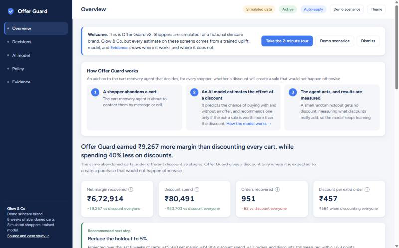
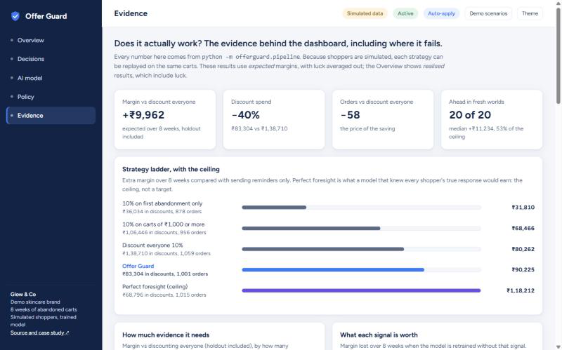
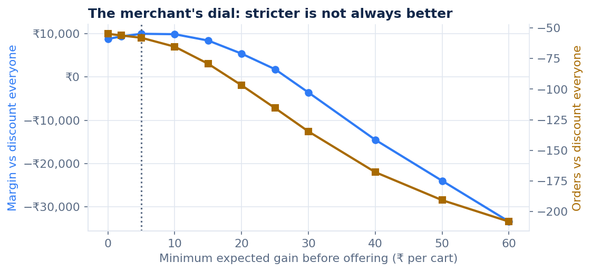
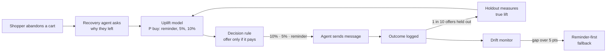
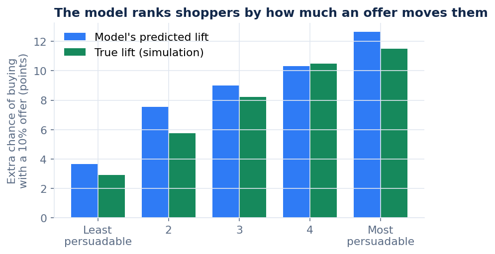
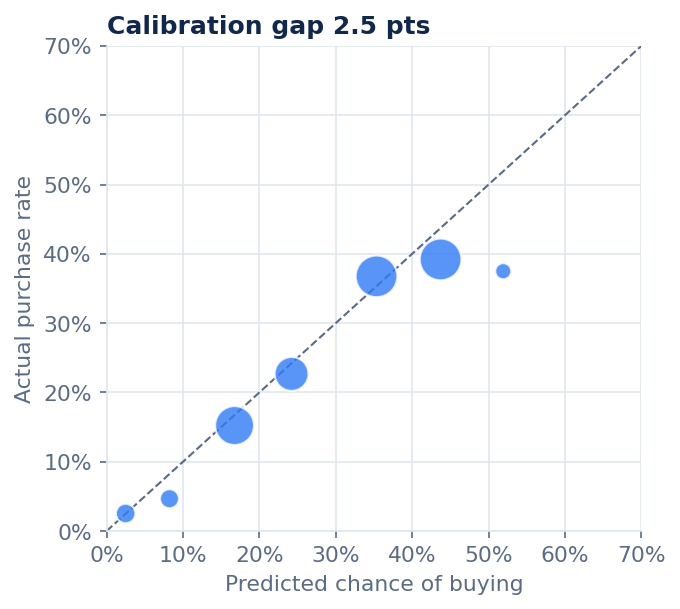

<div align="center">

# Offer Guard

**Discounts for the shoppers who need one. Reminders for everyone else.**

An AI decision layer for cart-recovery agents. It predicts, for each abandoned cart, whether a discount will change the shopper's decision, and spends discounts only where they create a sale.

[](https://github.com/rithi-shetty/offer-guard/actions/workflows/ci.yml) [](https://offer-guard-six.vercel.app/) [](pyproject.toml) [](LICENSE)

[**Live demo**](https://offer-guard-six.vercel.app/) ([mirror](https://rithi-shetty.github.io/offer-guard/)) · [Demo video](challenge-submission/Demo_Video.mp4) · [Product note](challenge-submission/Product_Note.pdf) · [Pitch deck](challenge-submission/Pitch_Deck.pptx) · [Decision log](docs/decisions.md)



</div>

## Overview

Cart-recovery tools report **recovery rate**, a metric that rises with every discount, including the ones given to shoppers who would have bought anyway. Offer Guard changes the question from *"will this shopper buy?"* to *"will a discount change whether they buy?"*, and makes the answer measurable.

Semi-finalist project from the **Razorpay AI PM Build Challenge**, rebuilt end to end as a working system: simulator, trained uplift model, decision engine, merchant dashboard, experiments and tests.

**Key results** (8 weeks, simulated D2C brand, 3,394 contacted carts):

| Metric | Result |
|---|---|
| Margin vs discounting every cart | **+₹9,962** |
| Discount spend | **−40%** |
| Robustness | Ahead in **20 of 20** freshly simulated brands (median +₹11,234) |
| Measured lift from offers | **12.0 points** (95% CI 7.4–16.6), via a random holdout |
| Trade-off | **1.7 points** lower recovery rate, shown openly in the dashboard |

> [!NOTE]
> All shoppers and outcomes are **simulated**. The model, decision rule, checks and dashboard would run unchanged on real logs; the numbers would not carry over. See [Limitations](#limitations).

## Table of contents

- [The problem](#the-problem)
- [The solution](#the-solution)
- [Results](#results)
- [Product insights](#product-insights)
- [Where it does not work](#where-it-does-not-work)
- [How it works](#how-it-works)
- [Getting started](#getting-started)
- [Project structure](#project-structure)
- [Documentation](#documentation)
- [Limitations](#limitations)
- [Roadmap](#roadmap)
- [Author](#author)
- [License](#license)

## The problem

Priya buys every month and got distracted. Arjun is new and hesitated at the price. Both abandon a ₹2,000 cart, both receive 10% off, and both buy. The recovery dashboard counts two recovered carts.

Only one was an extra sale. Priya would have returned anyway, so her ₹200 discount was margin given away. Shoppers who learn that abandoning a cart brings a coupon start waiting for one.

**Who it is for:** growth managers at Indian D2C brands who own cart recovery and the discount budget.

## The solution

| Capability | What it does |
|---|---|
| **Per-shopper decision** | Recommends a 10% offer, a 5% offer or a plain reminder for every abandoned cart |
| **Visible rule** | The AI only estimates probabilities; a one-line expected-value rule decides, shown with real numbers on every cart |
| **Built-in measurement** | A random 10% holdout measures what offers actually add, without trusting the model |
| **Merchant control** | Suggest-only mode, overrides, minimum-gain and budget settings, policy preview, pause switch, change history |
| **Safety net** | A drift monitor switches to reminder-first mode when predictions stop matching outcomes |
| **Shopper fairness** | Reminders never mention discounts; uncertain identity links never reduce an offer |

<table>
<tr>
<td width="50%"></td>
<td width="50%"></td>
</tr>
<tr>
<td align="center"><sub>Every decision shows its arithmetic</sub></td>
<td align="center"><sub>The Evidence screen reports failures as well as wins</sub></td>
</tr>
</table>

### Challenge version vs this repository

| | Challenge prototype (v1) | This repository (v2) |
|---|---|---|
| AI estimates | Simulated, written into the data | Trained two-part uplift model on randomised carts |
| Evidence | One strategy comparison | Learning curve, signal value, 6 stress tests, 20 fresh worlds, pilot power analysis |
| Engineering | Single HTML file | Python package, 21 tests, CI, one-command pipeline, JS/Python parity check |

## Results

The same carts, replayed under each strategy. Expected values, with the 10% measurement holdout included.

| Strategy | Margin vs reminders only | Discount spend | Orders |
|---|---:|---:|---:|
| 10% on first abandonment only | ₹31,810 | ₹36,034 | 878 |
| 10% on carts ≥ ₹1,000 | ₹68,466 | ₹1,06,446 | 956 |
| Discount everyone 10% | ₹80,262 | ₹1,38,710 | 1,059 |
| **Offer Guard** | **₹90,225** | **₹83,304** | **1,001** |
| Perfect foresight *(ceiling)* | ₹1,18,212 | ₹68,796 | 1,015 |


- **Realised outcomes agree.** Including luck, Offer Guard earned +₹9,267 more than discounting everyone.
- **The holdout has a price.** Without it the edge roughly doubles to +₹20,000. The holdout is what makes the effect provable.
- **The model is checked without trusting it.** It expected a 9.2-point lift; the holdout measured 12.0 (95% CI 7.4–16.6). Of discounted buyers, 57% would have bought anyway.
- **Smaller than the challenge claim.** The v1 prototype reported +₹17,855 and 54% less spend from simulated estimates. With a trained model the edge is smaller, and this README reports the smaller figure.

## Product insights

Rebuilding the product with a trained model changed several of the original decisions. Full reasoning is in the [decision log](docs/decisions.md).

<details open>
<summary><b>1. It is a platform feature, not a plugin</b></summary>

Trained only on one brand's carts, Offer Guard **loses ₹7,522** against discounting everyone. It needs about 8 brands' worth of randomised evidence before it wins reliably. That places it inside a payments platform that sees thousands of merchants, and makes data scale a moat. Only cart-level signals are pooled, never shopper identities.


</details>

<details>
<summary><b>2. The original pilot could not have proved the margin gain</b></summary>

The gain is about ₹3 per cart against ₹377 of cart-to-cart noise: detecting it needs about 2,59,000 carts per arm, while a 5-brand, 8-week pilot yields about 8,500. Discount savings are detectable in under a week. The [revised pilot plan](docs/pilot-plan.md) is built around what a pilot can measure.
</details>

<details>
<summary><b>3. The agent's "why did you leave?" question is part of the product</b></summary>

It is the most valuable signal, worth ₹6,931 over 8 weeks. When the agent rarely hears it, most of the edge disappears, so the recovery agent's script is in scope.


</details>

<details>
<summary><b>4. The safety net raised false alarms, so its trigger changed</b></summary>

The original drift check was too noisy on a two-week window and fired on a healthy model. The revised trigger fires in the week behaviour actually shifts, with 1 false alarm across 20 simulated brands.
</details>

<details>
<summary><b>5. The most accurate model was not the most profitable</b></summary>

On 55,000 held-out carts, the model with the best prediction accuracy earned less than a simpler two-part design. The observable estimates overlapped within their error bars, so the choice was made on reasoning and recorded as such.
</details>

<details>
<summary><b>6. Stricter is not safer</b></summary>

Raising the minimum-gain threshold past about ₹25 per cart turns the edge negative. The dashboard's policy preview shows this before a change is applied.


</details>

## Where it does not work

The full pipeline, re-run in worlds that each break one assumption:

| Scenario | vs discount everyone | Implication |
|---|---:|---|
| Thin margins (25–35%) | **+₹43,288** | Blanket discounts are most expensive here; best first customers |
| Behaviour shifts in week 4 | **+₹15,240** | Safety net trips in week 4 and protects about ₹10,000 |
| Base case | **+₹9,962** | |
| Agent hears the reason on only 30% of carts | +₹5,365 | Most of the edge depends on the conversation signal |
| Fat margins (70–80%) | **−₹3,533** | Nearly every discount pays for itself; blanket 10% is hard to beat |
| Every shopper responds alike | **−₹11,140** | Nothing to target; holdout and lift-ranking checks catch this before scaling |

These define the go-to-market filter: thin-margin merchants, mixed shopper bases, and a recovery agent that asks why the shopper left.


## How it works



**Decision rule.** The model predicts; a fixed rule decides:

```text
value of offer = P(buy | offer) × (margin − discount) − P(buy | reminder) × margin
```

The second term charges each offer for shoppers who would have bought anyway. An offer is made only if its value clears the merchant's minimum gain.

**Model.** A two-part uplift model: gradient-boosted trees estimate the baseline (*would they buy after a reminder?*) and a regularised logistic model estimates the lift (*how much does an offer add?*). It trains only on carts where the offer was assigned at random. Inputs, exclusions and failure modes are documented in the [model card](docs/model-card.md).

| Ranks shoppers by persuadability | Calibrated against outcomes |
|---|---|
|  |  |
| True lift rises from 2.9 to 11.5 points across quintiles | Mean calibration gap: 2.5 points |

**Verification.** On every page load, the dashboard re-computes all 3,517 decisions in JavaScript and checks them against the Python reference engine.

**Tech stack:** Python (NumPy, pandas, scikit-learn, SciPy, Matplotlib), vanilla JavaScript, pytest, GitHub Actions, Vercel.

## Getting started

### Prerequisites

- Python 3.10 or later
- About 6 minutes for the full pipeline (2 minutes with `--quick`)

### Installation

```bash
git clone https://github.com/rithi-shetty/offer-guard.git
cd offer-guard
python -m venv .venv
source .venv/bin/activate        # Windows: .venv\Scripts\activate
pip install -r requirements.txt
```

### Usage

| Task | Command |
|---|---|
| Run the full pipeline (simulate, train, evaluate, write reports) | `python -m offerguard.pipeline` |
| Run a faster, smaller pipeline | `python -m offerguard.pipeline --quick` |
| Run the tests | `pytest -q` |
| Open the dashboard locally | `python -m http.server 8000 --directory web`, then visit http://localhost:8000 |
| Rebuild the dashboard from the v1 prototype | `python tools/build_dashboard.py` |

Every figure in this README is read from `reports/results.json`, which the pipeline regenerates. Runs are seeded and reproducible.

## Project structure

```text
offer-guard/
├── offerguard/              # Core package
│   ├── config.py            # Simulation assumptions, in one place
│   ├── simulate.py          # Shoppers, carts, learning and live phases, drift monitor
│   ├── features.py          # Model inputs, and what the model may not see
│   ├── model.py             # Uplift model candidates
│   ├── policy.py            # Decision rule, holdout, messages, explanations
│   ├── evaluate.py          # Strategy scoring, holdout readout, calibration
│   ├── experiments.py       # Bake-off, learning curve, stress tests, pilot power
│   ├── figures.py           # README charts
│   └── pipeline.py          # End-to-end run
├── web/                     # Static dashboard (deployed to Vercel and GitHub Pages)
├── tools/                   # Builds web/ from the v1 prototype as a reviewable patch
├── tests/                   # 21 tests, including JS/Python decision parity
├── docs/                    # Model card, decision log, pilot plan, screenshots
├── reports/                 # results.json and figures
└── challenge-submission/    # Original note, deck, video, build log and prototype
```

## Documentation

| Document | Contents |
|---|---|
| [Model card](docs/model-card.md) | Training data, inputs and exclusions, checks, known failure modes |
| [Decision log](docs/decisions.md) | 14 product and AI decisions, with alternatives and evidence |
| [Pilot plan](docs/pilot-plan.md) | Revised pilot design, success criteria and stop rules |
| [Challenge submission](challenge-submission/README.md) | The original product note, pitch deck, demo video and prototype |
| [AI build log](challenge-submission/AI_Build_Log.md) | How AI tools were used, and the outputs that were rejected |

## Limitations

- **Simulated data.** Parameters in [`config.py`](offerguard/config.py) are invented and anchored to the challenge prototype's shopper mix.
- **No coupon-waiting dynamics.** Simulated shoppers do not learn to wait for discounts, so the long-run benefit of discounting less is not credited.
- **Pooled training is simplified.** Cross-merchant pooling uses de-identified cart rows; production would use aggregated model parameters.
- **Legal interpretation.** The DPDP Act reading behind the consent design is a product interpretation, not legal advice.

## Roadmap

- [x] Trained uplift model, simulator and decision engine
- [x] Stress tests, robustness runs and pilot power analysis
- [x] Merchant dashboard with Evidence screen
- [ ] Validate with Razorpay: how the agent picks offers today, and Thirdwatch score access
- [ ] Model coupon-waiting behaviour in the simulator
- [ ] Adapter for real recovery-agent logs
- [ ] Federated training across merchants using aggregated parameters only
- [ ] 8-week pilot with 3–5 merchants, per the [pilot plan](docs/pilot-plan.md)

## Author

**Rithika U Shetty**, ISB PGP '27 · [GitHub](https://github.com/rithi-shetty)

Product decisions, research and verification are the author's own. AI tools were used for research, critique and code; how they were used is documented in the [AI build log](challenge-submission/AI_Build_Log.md).

## License

Released under the [MIT License](LICENSE).

<sub>Offer Guard is an independent project created for the Razorpay AI PM Build Challenge. It is not affiliated with, endorsed by or a product of Razorpay. Razorpay, Magic Checkout and Thirdwatch are referenced only to describe the challenge context.</sub>
